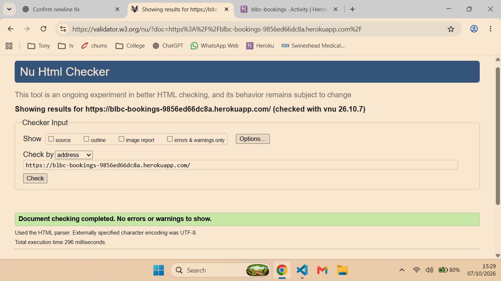
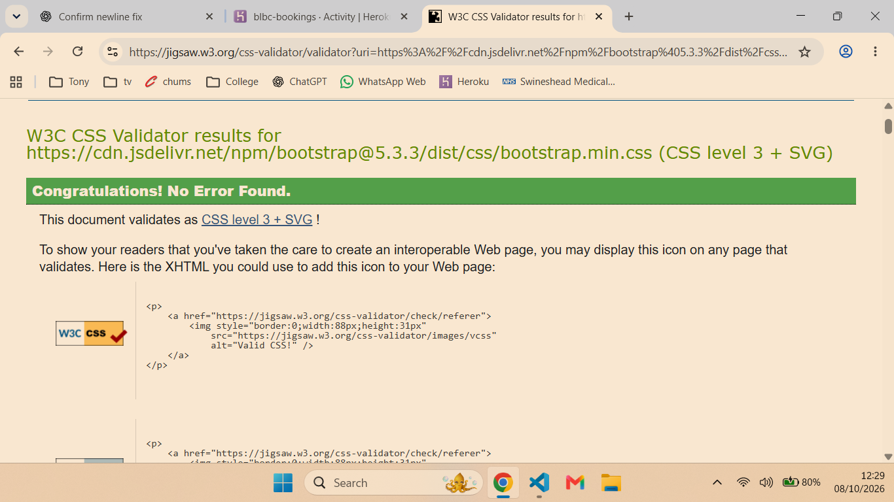
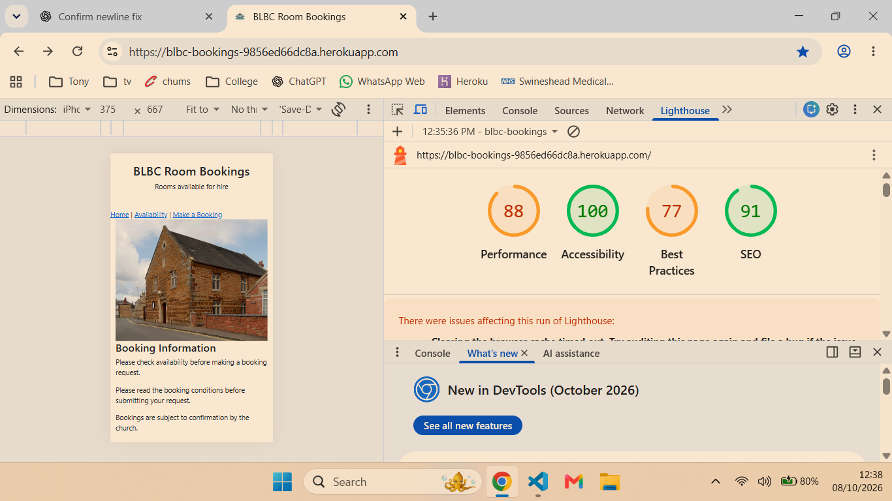
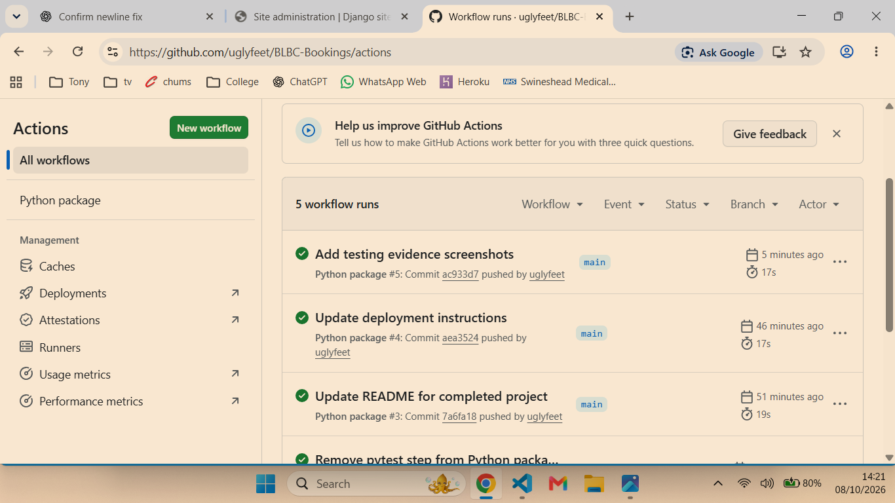
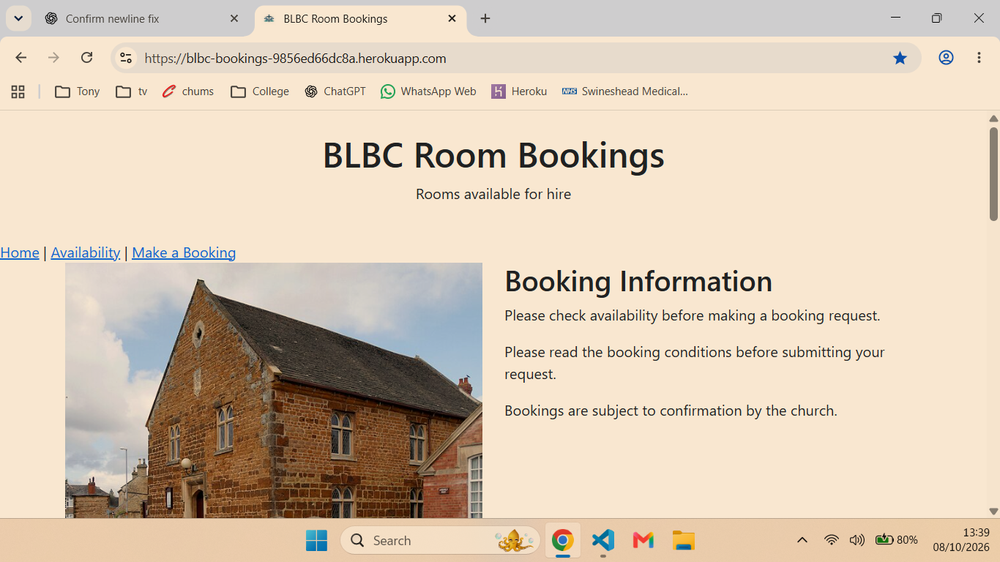
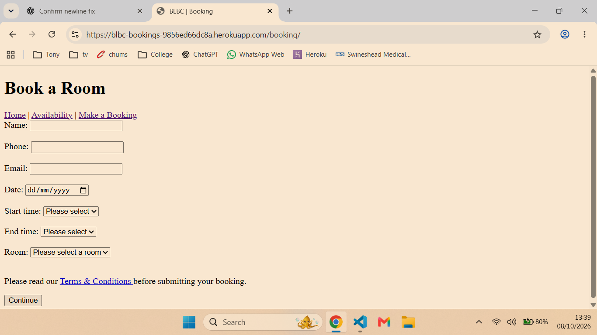
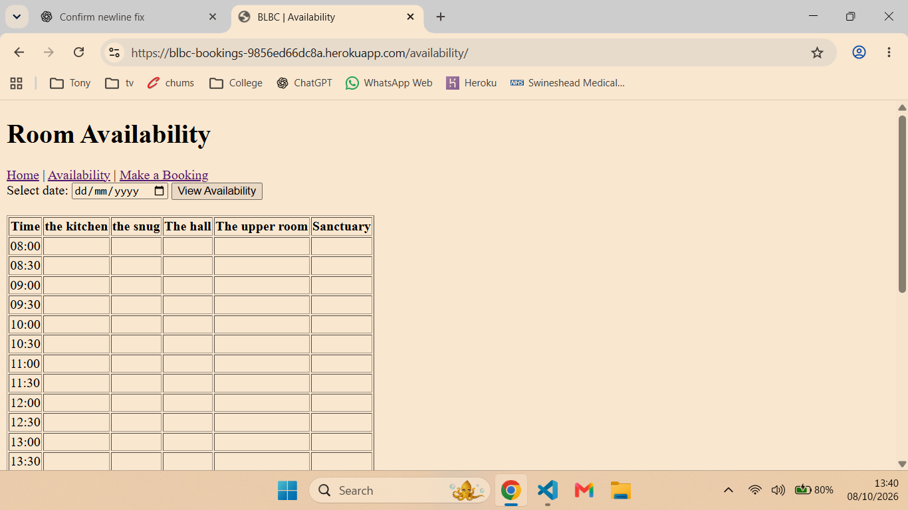
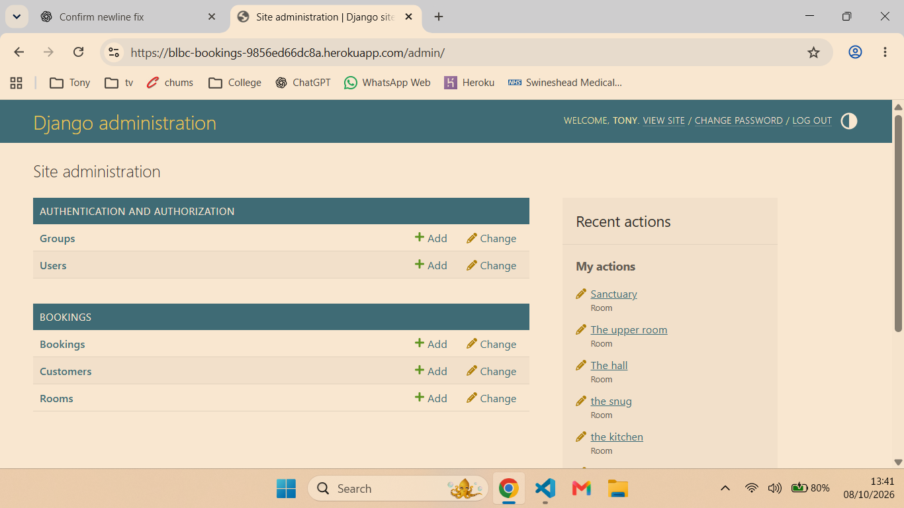

# Testing Strategy

The BLBC Booking System will be tested throughout development to ensure it meets the functional and non-functional requirements.

The following types of testing will be carried out:

- Manual testing of all user functionality.
- Automatic testing of HTML and CSS
- Validation testing of all form inputs.
- Responsiveness testing on desktop, tablet and mobile devices.
- Browser compatibility testing.
- User acceptance testing to ensure the system meets user requirements.

Test results will be recorded during the development phase.

## Test Evidence

### HTML Validation

### CSS Validation

### Lighthouse

### GitHub CI

### Home page

### Booking page

### Availabilty page

## Admin page

## Manual Test Results

The following manual tests were carried out during development and on the deployed website.

| Test | Expected result | Outcome |
|---|---|---|
| Submit a booking with valid details | Booking request is accepted | Passed |
| Email verification | Verification code is sent and accepted | Passed |
| Submit a booking with missing required details | Validation prevents an incomplete booking | Passed |
| Attempt to double-book a room | Conflicting booking is prevented | Passed |
| Select a past booking time | Booking is rejected | Passed |
| Select an invalid time slot | Only half-hour intervals are permitted | Passed |
| Calculate the booking fee | Correct fee is calculated and displayed | Passed |
| View room availability | Availability is displayed correctly | Passed |
| View a booking in Django admin | Booking details are displayed correctly | Passed |
| Amend a booking through the website | Changes are saved correctly | Passed |
| Edit or delete a booking through Django admin | Changes are saved or the booking is removed | Passed |
| Check booking amendment history | Website amendments are not recorded in Django admin history | Improvement identified |

The deployed website was tested to confirm that booking submission, email verification and the display of booking details in Django admin worked correctly.

**Note:** The booking amendment history limitation is documented under Future Improvement.

### Future Improvement – Booking Amendment History

When a customer amends a booking through the website, the changes are saved correctly, but they are not recorded in Django admin's history log. Changes made directly through Django admin are recorded. A future enhancement could provide a history of customer booking amendments for easier tracking and auditing.

This does not prevent customers from amending their bookings, but it would improve administration and traceability.